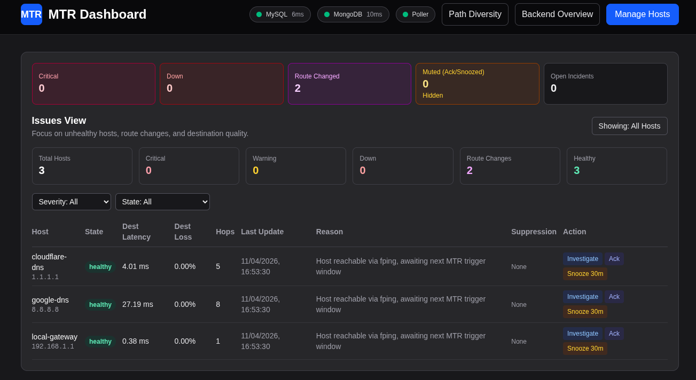
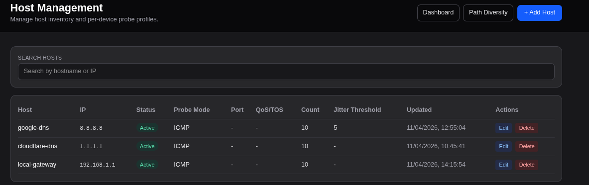
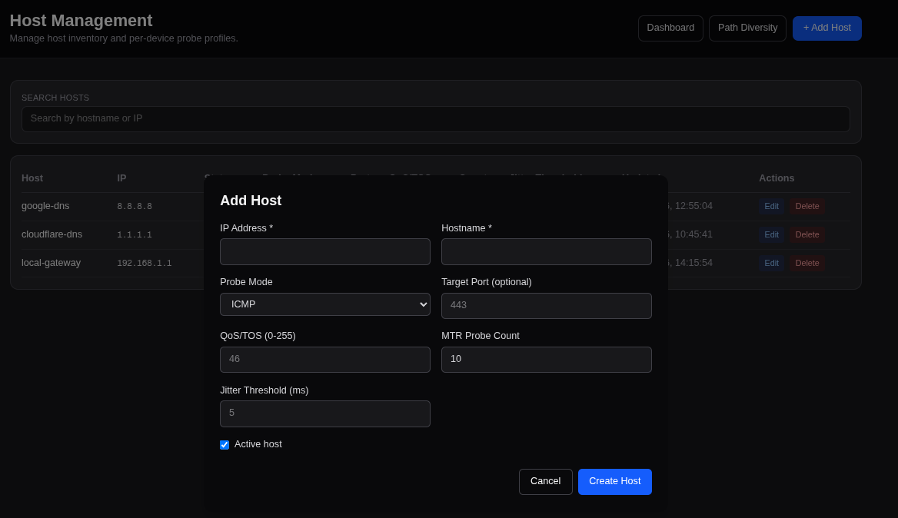
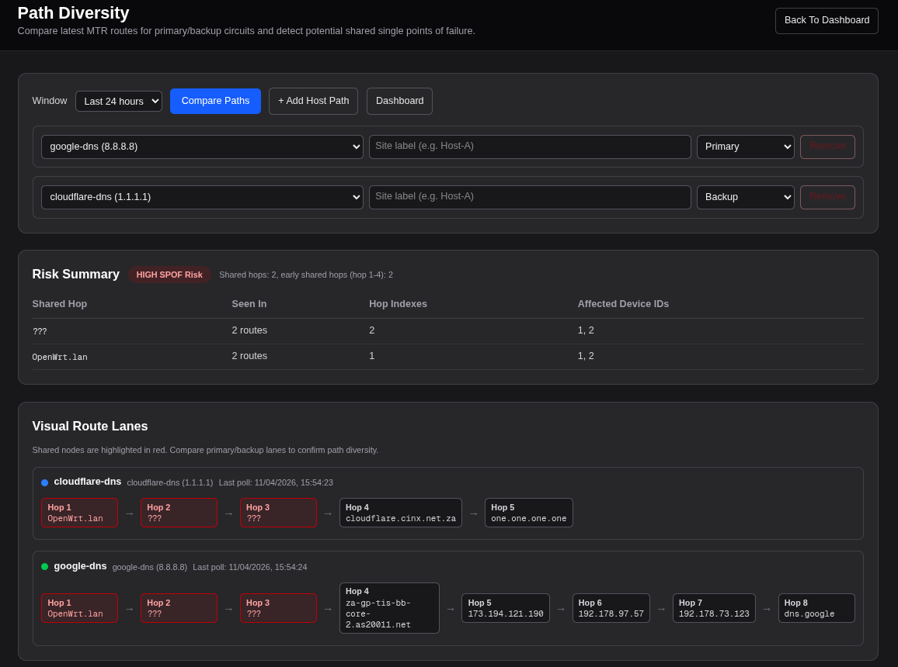
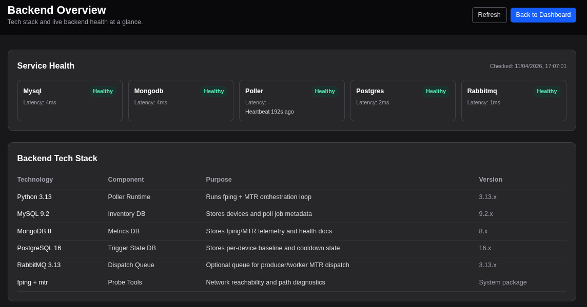

# MTR Dashboard

> **Proof of concept**: this repository demonstrates what **GitHub Copilot** can help build for a network monitoring workflow. It is intended as a demo / POC, **not** a production-ready platform.

`MTR Dashboard` combines a Python poller, MySQL inventory, MongoDB telemetry storage, and a Next.js UI to monitor hosts with `fping` and `mtr`, highlight route changes, and expose data through queryable API endpoints.

---

## ✨ What this project shows

- Live host health and incident-oriented dashboarding
- Host lifecycle management (add, edit, remove monitored devices)
- fping and MTR telemetry capture with route change visibility
- Path diversity comparison to spot shared hops / SPOF risk
- Backend service overview for the supporting stack
- Session and API-token protected endpoints for integration

---

## 📸 Screenshots

### Dashboard


### Host Management


### Add Host Modal


### Path Diversity


### Backend Overview


---

## 🏗️ Stack

| Layer | Technology | Purpose |
| --- | --- | --- |
| Frontend | Next.js 16 / React 19 / TypeScript | Dashboard UI and API routes |
| Poller | Python 3.13 | Runs fping/MTR jobs and updates telemetry |
| Inventory DB | MySQL 9.2 | Stores devices, auth users, and app metadata |
| Metrics DB | MongoDB 8 | Stores fping/MTR results and incident state |
| Trigger State | PostgreSQL 16 | Stores per-device baseline / cooldown state |
| Queue | RabbitMQ 3.13 | Optional async dispatch path |

---

## ⚠️ POC status / limitations

This repo is being prepared for public GitHub upload as a **proof-of-concept showcase**.

Please assume the following:

- it is **not production hardened yet**
- local `.env` files and secrets must stay out of Git
- the current security findings are documented in [`SECURITY_NOTES.md`](SECURITY_NOTES.md)
- Docker networking and privileges are tuned for traceroute diagnostics, not locked-down production hosting

---

## 🚀 Getting started with Docker

> Recommended platform: **Linux with Docker CE + Docker Compose plugin**. Native Linux networking behaves best for `mtr` and `fping`.

### 1) Clone the repository

```bash
git clone <your-github-url>
cd MTR_Dashboard
```

### 2) Create your local environment file

```bash
cp .env.docker.example .env.docker
```

Edit `.env.docker` and set your own values for at least:

- `MYSQL_ROOT_PASSWORD`
- `MYSQL_PASSWORD`
- `POSTGRES_PASSWORD`
- `SESSION_SECRET`
- any demo usernames / passwords you want to change

> Keep `.env.docker`, `backend/.env`, and `frontend/.env.local` **local only**. They are intended to stay untracked.

### 3) Start the stack

```bash
docker compose --env-file .env.docker up -d --build
```

Or use the helper:

```bash
./scripts/docker-first-run.sh
```

### 4) Open the app

- UI: `http://localhost:3000`
- RabbitMQ management: `http://localhost:15672` (if enabled)

### 5) View logs

```bash
docker compose logs -f frontend
docker compose logs -f backend
```

### 6) Stop the stack

```bash
docker compose --env-file .env.docker down
```

To also remove named volumes:

```bash
docker compose --env-file .env.docker down -v
```

---

## 🔐 Authentication for API consumers

Most endpoints are protected when `SECURITY_ENFORCE_AUTH=true`.

You can authenticate in either of these ways:

1. **Session cookie** obtained from `/api/auth/login`
2. **API token** sent via:
   - `Authorization: Bearer <token>`
   - or `x-api-key: <token>`

### Login example

```bash
curl -c cookies.txt -X POST http://localhost:3000/api/auth/login \
  -H "Content-Type: application/json" \
  -d '{"username":"admin","password":"<your-local-password>"}'
```

### Reuse the session cookie

```bash
curl -b cookies.txt http://localhost:3000/api/health
```

---

## 🔌 API endpoints for other tools

All endpoints return a JSON envelope similar to:

```json
{
  "success": true,
  "data": {},
  "error": null
}
```

### Core monitoring endpoints

| Endpoint | Method(s) | Role | Purpose |
| --- | --- | --- | --- |
| `/api/health` | `GET` | `viewer` | Health check for MySQL, MongoDB, and poller status |
| `/api/mtr/issues` | `GET`, `POST` | `viewer` / `operator` | Query current issues and ack/snooze incidents |
| `/api/mtr/stats` | `GET` | `viewer` | Time-series stats for a device (`deviceId`, `hours`, `maxPoints`, `includeRealtime`, `start`, `end`) |
| `/api/mtr/route-compare` | `GET` | `viewer` | Compare latest routes across multiple devices (`deviceIds`, `hours`) |
| `/api/mtr/probe` | `GET`, `POST` | `operator` | Queue on-demand `fping`/`mtr` probes and check request status |
| `/api/mtr/realtime` | `GET`, `POST` | `operator` | Inspect or start/stop a realtime fping session |
| `/api/backend/overview` | `GET` | `admin` | Backend stack overview including service health |

### Device and admin endpoints

| Endpoint | Method(s) | Role | Purpose |
| --- | --- | --- | --- |
| `/api/devices` | `GET` | `viewer` | List monitored hosts |
| `/api/devices?id=<id>` | `PUT`, `PATCH`, `DELETE` | `admin` | Update or remove a host |
| `/api/devices` | `POST` | `admin` | Add a new host |
| `/api/admin/users` | `GET`, `POST`, `PATCH` | `admin` | Manage app users |
| `/api/admin/tokens` | `GET`, `POST`, `DELETE` | `admin` | Create and revoke API tokens |
| `/api/auth/login` | `POST` | public | Login and receive a session cookie |
| `/api/auth/logout` | `POST` | authenticated | Clear the session cookie |
| `/api/auth/session` | `GET` | authenticated | Inspect the current logged-in user |

### Example queries

```bash
# Health
curl -b cookies.txt http://localhost:3000/api/health

# Devices
curl -b cookies.txt http://localhost:3000/api/devices

# Issues view (include healthy hosts)
curl -b cookies.txt "http://localhost:3000/api/mtr/issues?includeHealthy=true"

# Stats for device 1 over the last 24 hours
curl -b cookies.txt "http://localhost:3000/api/mtr/stats?deviceId=1&hours=24&maxPoints=120"

# Compare two devices for path diversity
curl -b cookies.txt "http://localhost:3000/api/mtr/route-compare?deviceIds=1,2&hours=24"

# Queue a manual probe
curl -b cookies.txt -X POST http://localhost:3000/api/mtr/probe \
  -H "Content-Type: application/json" \
  -d '{"deviceId":1,"mode":"mtr"}'
```

---

## 📁 Repository hygiene for GitHub upload

Before publishing, keep these local-only files out of version control:

- `.env.docker`
- `backend/.env`
- `frontend/.env.local`
- log files, virtual environments, and build artifacts

Example templates such as `.env.docker.example`, `backend/.env.example`, and `frontend/.env.example` are safe to keep in the repo.

---

## 🛣️ Future hardening / cleanup

Planned follow-up work includes:

- dependency and container hardening
- non-root container users
- security remediation for documented scan findings
- CI/CD and automated tests
- stronger production auth and secret handling

If you use this repo publicly, present it as a **GitHub Copilot-assisted network monitoring POC** rather than a finished production system.
